# AA2CG

**0.1.0 beta 1 — first public beta.** Package version: `0.1.0b1`.
GitHub release tag: `v0.1.0-beta.1`. See the [release notes](CHANGELOG.md).

**Create your own coarse-grained force fields from LAMMPS trajectories—all in one application.**

AA2CG is a desktop application for building, optimizing and
evaluating coarse-grained (CG) force fields from atomistic simulations. Import
your LAMMPS structure and trajectories, define bead types and mapping rules,
fit the interactions, generate simulation inputs, and optimize the model against
selected properties. Compare the resulting CG simulation with the atomistic
reference in the same workspace.

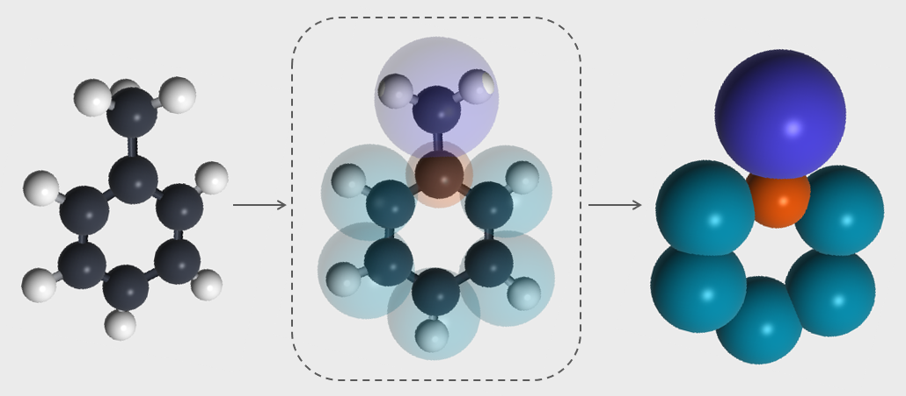

*Methylbenzene (toluene): atomistic structure → mapped groups → coarse-grained beads.*

## Why this project?

Coarse graining involves several connected tasks: identifying molecular species,
choosing a mapping, fitting interactions, preparing tables, running simulations
and evaluating the result. Moving between separate tools and scripts can make
that workflow difficult to learn and maintain.

The workbench brings these tasks together in a guided, visual workflow. Automatic
species detection and configurable defaults handle much of the setup, while
mapping rules, fitting parameters, table processing and optimization objectives
remain under your control. Projects keep those decisions and their results
together, so you can return to a model and continue developing it.

The application uses [OpenMSCG](https://github.com/uchicago-voth/OpenMSCG) for its
coarse-graining backend, LAMMPS for simulations and Optuna for property-based
optimization. Generated mappings, interaction tables and simulation inputs are
accessible outside the GUI, providing a foundation for extending the workflow
to your own research methods.

```text
Inspect → Map → Configure fit → Fit → Prepare tables → LAMMPS → Refine → Validate
                                                             optional
```

## Highlights

- Detect molecular species and review their connectivity in 2D and 3D.
- Define custom bead types and mapping rules visually, or use automatic united-atom mapping.
- Adjust fitting bounds, spline spacing and order directly against distributions.
- Choose independent or coupled force matching.
- Preview processed interaction tables over the raw results.
- Generate LAMMPS inputs and check simulation initialization.
- Optimize pair interactions against selected properties using Optuna-driven LAMMPS trials.
- Compare AA and CG properties, distributions and molecular trajectories.
- Keep multiple systems, saved settings and generated results in one project.

## What you need

For the standard workflow, provide:

- An atomistic LAMMPS data file containing atom identities, masses and molecular
  connectivity.
- A matching LAMMPS text-dump trajectory containing atom IDs, coordinates, box
  information and **atomic forces (`fx`, `fy`, `fz`)** for force matching.
- Optionally, an AA property time-series file for comparison with CG properties.

Coordinates alone are not enough for force matching. Atom IDs and atom counts
must agree between the structure and trajectory. Use consistent units: generated
LAMMPS simulations use `units real`; the application is not a general-purpose
unit or trajectory-format converter.

If a structure file is unavailable, an explicit connectivity-inference option
can help prepare one from a compatible dump. Inferred bonds must be reviewed;
they are not equivalent to a supplied, verified topology. See the
[workflow reference](docs/workflow-reference.md#using-the-application) for details.

## Workflow

### 1. Inspect

Load the atomistic inputs and run the checks. Review detected species, inspect
the 2D molecular drawing and play the trajectory in 3D. Focus on the whole
system, one species or a single molecule without changing the source data.

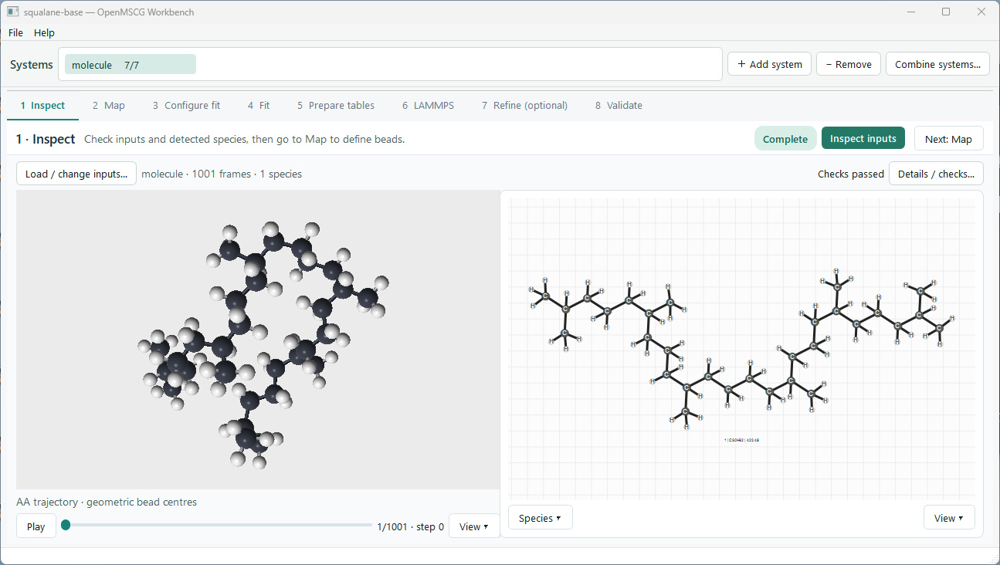

<details>
<summary>View the full atomistic system</summary>

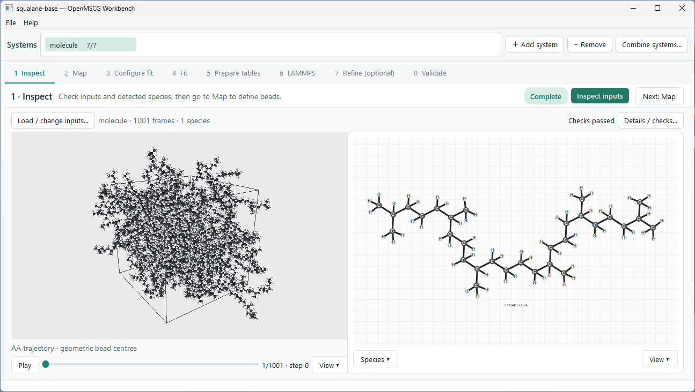

</details>

<details>
<summary>Another species: methylbenzene in 2D and 3D</summary>

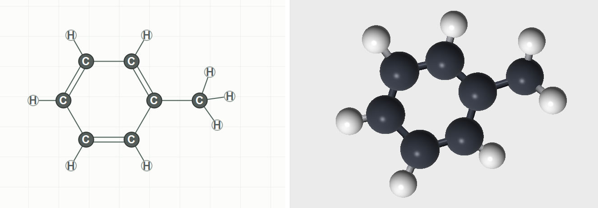

</details>

### 2. Map

Select atoms in the sketcher and create bead rules. The mapping preview replaces
grouped atoms with colored beads, while the 3D overlay shows how those beads
relate to the atomistic molecule. Bead colors match across both views. Build the
mapped trajectory when the mapping is ready.

[Watch or download the bead-typing demo (MP4)](markdown-resources/bead-typing.mp4).

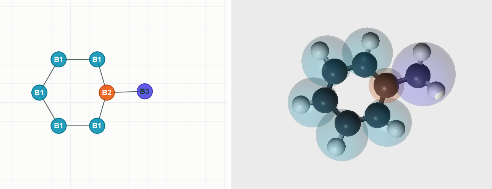

*The same bead types have the same colors in the sketcher and the 3D overlay.*

<details>
<summary>View the Squalane mapping workspace</summary>

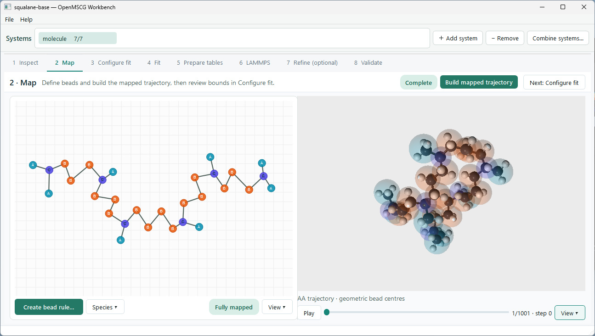

</details>

### 3. Configure fit

Review the sampled interaction distributions before fitting. Drag the fitting
bounds, choose automatic or manual ranges, and adjust spline spacing and order
per interaction. Original automatic bounds remain visible for comparison;
Reset restores the generated settings.

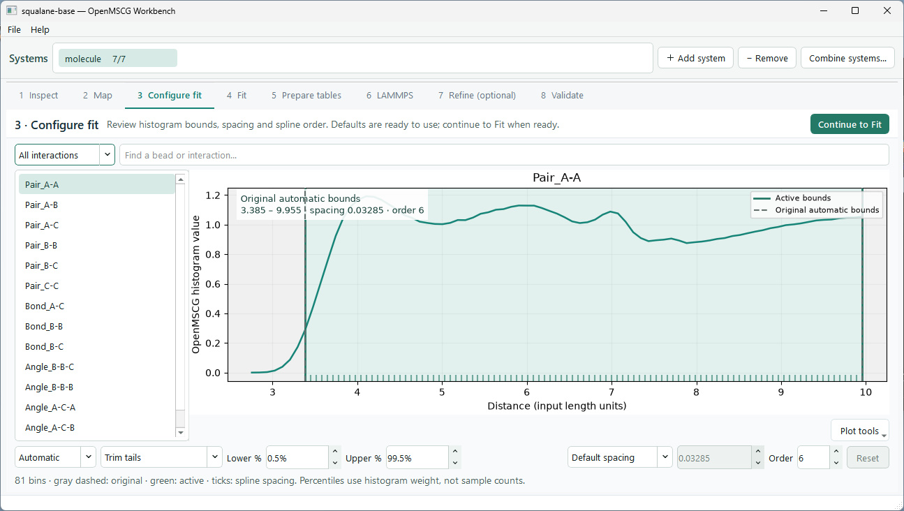

### 4. Fit

Run force matching and inspect the raw energy and force curves alongside their
fit settings. Independent fitting is the default; coupled fitting is also
available. Changing a setting does not silently launch a new calculation.

<details>
<summary>View force-matching settings and raw results</summary>

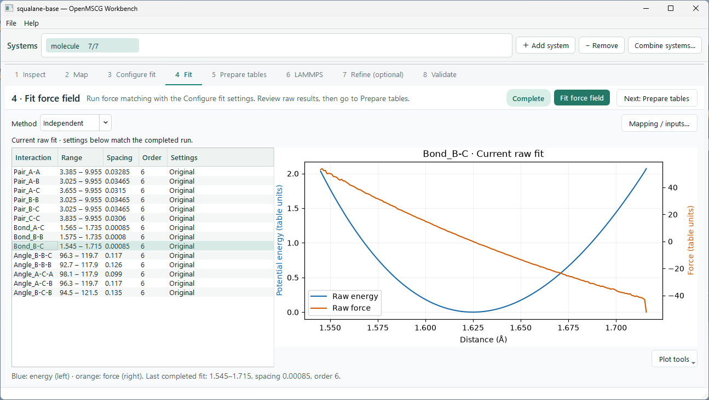

</details>

### 5. Prepare tables

Compare raw and processed curves on a shared plot. Keep automatic processing or
adjust smoothing, trimming and tail extension per interaction. Preview first,
then explicitly export the prepared tables.

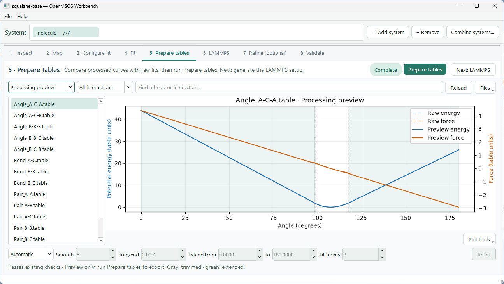

### 6. LAMMPS

Generate `input.data`, `structure.data` and the interaction tables. Review the
inputs and optionally run the smoke test. This checks initialization only—it
does not run production dynamics or establish model stability.

<details>
<summary>View generated inputs and the smoke-test controls</summary>

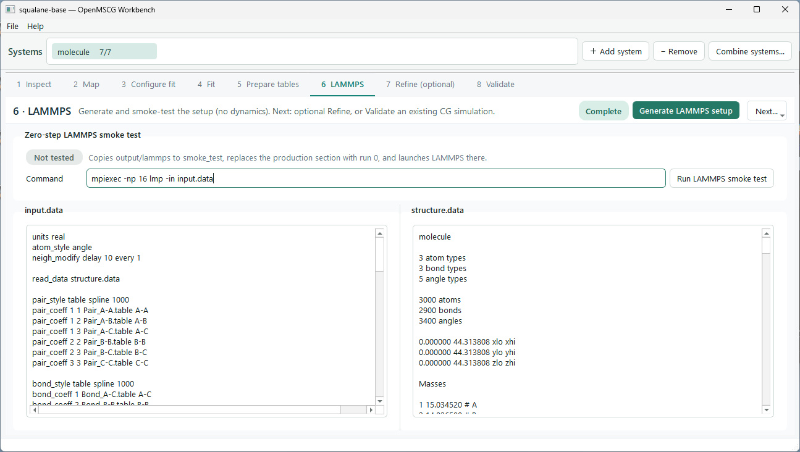

</details>

### 7. Refine — optional

Run Optuna trials that apply Gaussian corrections to pair tables and score the
resulting LAMMPS simulations against your selected property objectives. An
optional structural contribution can also be included in the objective.

The **Simulation protocol…** dialog places optional **Ramp-up** and **Production**
side by side, with timestep, temperature, pressure and per-property scoring windows.
Ramp-up, equilibration and sampling lengths are entered in steps; the summary
shows their elapsed time using the selected timestep.
A baseline run checks the unmodified tables first. **Explore → Refine** combines
a broad Gaussian search with smaller changes around its best valid result, using
separate trial budgets. **Continue…** restores a saved study and adds more trials
without replacing earlier outputs; new studies use separate folders.
**Trial results…** shows scores, rejection reasons and LAMMPS failure messages.
Trial storage can retain everything, improvement milestones or only the best
trial. Cleanup is opt-in: discarded and failed run folders are removed, while
settings, scores and logs are archived separately. In cleanup modes, the final
best result is stored once, without a duplicate trial trajectory.

Choose the target properties, weights and tolerances to guide the optimization.
The current method tunes Gaussian corrections to the fitted pair potentials.
You can also skip refinement and run the generated LAMMPS setup externally.

<details>
<summary>View property objectives and refinement controls</summary>

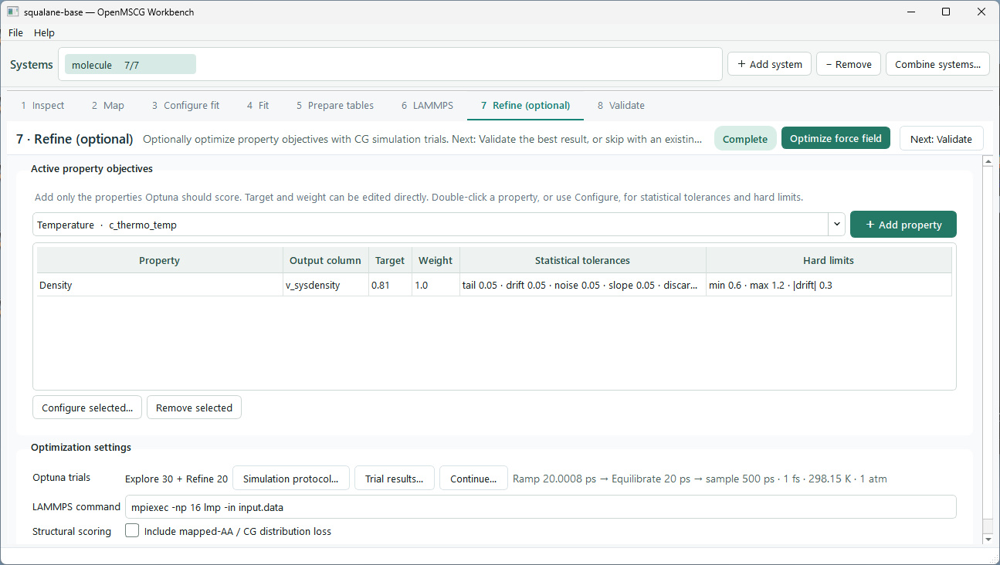

</details>

### 8. Validate

Compare distributions and matching AA/CG properties side by side. Load AA
property data when it is not already available; trajectory coordinates do not
automatically supply thermodynamic reference values.

**Sampling…** selects up to **150 evenly spaced frames per trajectory** by default,
across the full available trajectory rather than only its final frames. Optionally
discard an initial percentage and adjust the frame limit; settings are saved per
system. Shorter trajectories use all remaining frames. Apply, then run
**Compare AA and CG** to refresh the structural checks. Property-file averages
and optimization scoring are unchanged; sampling alone does not prove convergence.

In **3D visuals**, view AA and independent CG trajectories together, with shared
species/molecule selection, linked cameras and concurrent playback. Playback
uses relative trajectory progress—not identical physical times or corresponding
instantaneous conformations. Validation requires an actual CG trajectory, not
just a successful smoke test.

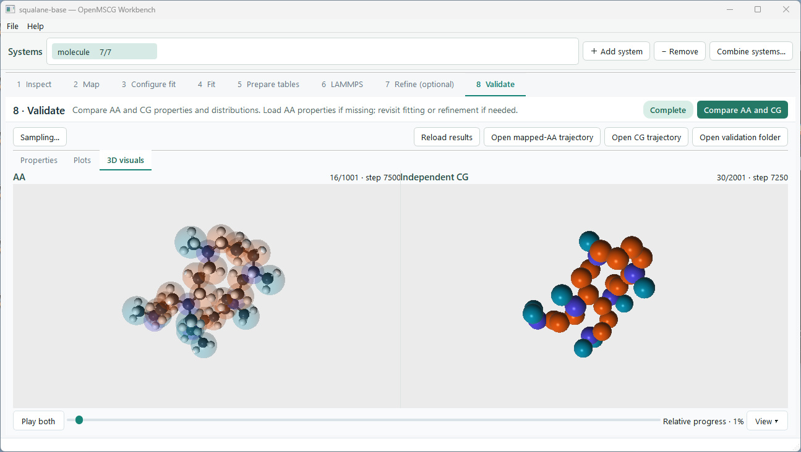

*Compare one molecule at a time, with linked views and playback by relative trajectory progress.*

<details>
<summary>View the full AA and CG systems side by side</summary>

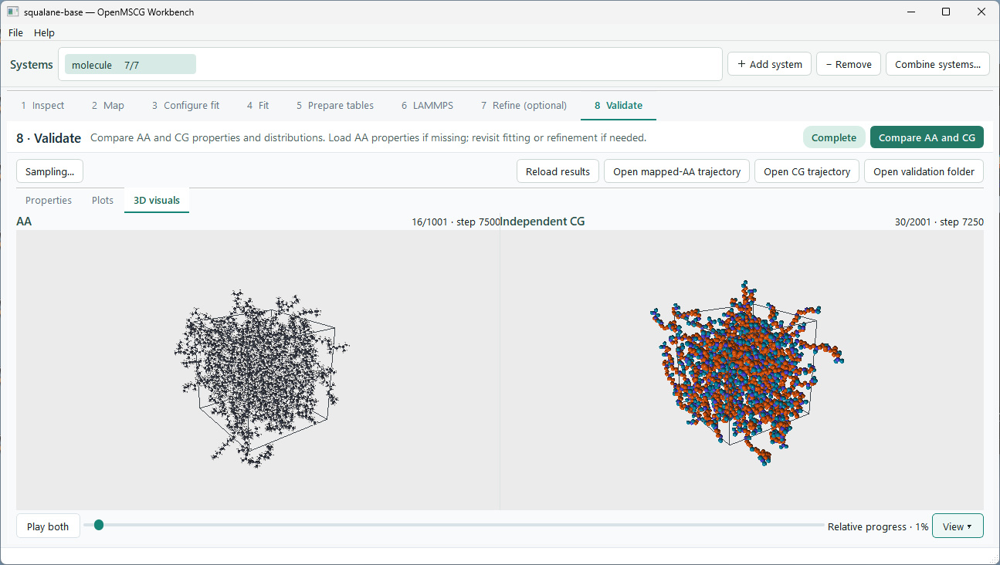

</details>

For multi-system work, **Combine systems** provides a separate workflow for
merging at least two optimized systems, with optional further optimization.

## Installation

Download the source and open a terminal in the application directory containing
`run_gui.py`, `pyproject.toml` and the environment files.

### Linux — full workflow

Use a compatible OpenMSCG installation and an OpenGL 3.3-capable graphics setup.
For a fresh Linux x86-64 environment, the supplied Conda recipe is:

```bash
conda env create -f environment-linux.yml
conda activate openmscg-workbench
python run_gui.py
```

The recipe specifies Python 3.8 and OpenMSCG 0.9.0. It is an environment
specification, **not a tested lockfile**. If you already have a working Python
3.7/OpenMSCG environment, keep it and use compatible GUI dependencies; do not
replace it with the fresh-environment recipe. Python 3.7 compatibility has not
been fully execution-validated.

### Windows — interface and preview

```powershell
conda env create -f environment-windows.yml
conda activate openmscg-workbench-preview
python run_gui.py
```

The Windows recipe supplies the GUI dependencies but **does not include
OpenMSCG**. Use it to inspect compatible inputs/results and work with the
interface; use a configured Linux environment for the OpenMSCG-backed workflow.

Conda is an installation route, not a runtime requirement. A compatible existing
Python environment can launch `python run_gui.py` directly. The application does
not install dependencies automatically, and `pip install .` alone does not
provision the runtime dependencies.

### LAMMPS execution

Install LAMMPS separately, plus an MPI launcher if using MPI. Set the launch
command in **LAMMPS** or **Refine** to match your machine. For example:

```text
lmp -in input.data
```

An MPI example is `mpiexec -np 16 lmp -in input.data`; adjust the executable and
process count to your installation. The application's mapping/fitting worker
count and LAMMPS's MPI process count are separate settings.

## First project

The welcome window offers **New project**, **Open project** and **Follow the
tutorial**. The Squalane tutorial is a movable, non-blocking popup. Download and
extract the raw input ZIP, create a blank project, then manually load the files,
select atoms, create each bead rule and start each calculation. The tutorial
highlights relevant controls and follows saved progress; it does not prepare
mapping rules, change defaults, install software or launch calculations.

The input ZIP contains `structure.data`, `aa.lammpstrj` and `properties.txt`—not
a preconfigured project. The download URL is currently **[PLACEHOLDER: Squalane
input ZIP link]**; replace `<LINK>` in
`src/openmscg_gui/tutorial_data/example.json` when publishing. The tutorial stays
available while that URL is pending, for users who already have the inputs.

Use **Back**, **Next** or **Exit guide**. Find project actions and workflow controls
in the main window; the guide does not duplicate them or switch tabs for you.
Completed actions show completion text instead of asking you to run them again.
Closing an editing popup leaves the guide open. Optional refinement and
comparison instructions can be skipped, but actual validation and CG playback
require a simulation trajectory. **Help → Squalane tutorial…** opens this guide;
**Help → Guided introduction…** retains the general guide for your own inputs.
Uncheck **Show welcome on startup** to enter the workspace directly next time.

1. Create a project in a dedicated folder through **File**.
2. Load your atomistic structure and trajectory in **Inspect** and review checks.
3. Define the mapping and build the mapped trajectory in **Map**.
4. Review distributions, run **Fit**, and **Prepare tables**.
5. Generate the LAMMPS setup and check initialization.
6. Run **Refine**, or simulate externally, then open **Validate**.

If simulating externally, retain the compatible CG trajectory at the system's
`output/lammps/cg.lammpstrj`. See the
[workflow reference](docs/workflow-reference.md) for detailed controls, defaults,
property-file handling and output conventions.

## Scientific scope

The workflow produces tabulated CG force fields from atomistic reference data,
with optional property-based optimization and structural comparison. Model
quality depends on the reference sampling, mapping, interaction representation
and chosen objectives. Assess convergence, structural fidelity and relevant
properties under the conditions where the model will be used; a successful
simulation or low optimization score alone does not establish transferability.

## Project files and extensibility

Projects store settings in `openmscg-project.json`, with per-system outputs:

```text
openmscg-project.json
systems/
  system-<id>/
    output/          # Mapping, fits, processed tables and LAMMPS setup
    optimization/    # Trial records, retained trial data and best result
    validation/      # Comparison results
merge/               # Combined-system outputs, when used
```

Use **File → Export project…** to share a portable ZIP. **Save** still saves the
working project normally. Export first saves the current settings, then offers:

- **Best result** (default): linked inputs, mapping/settings, generated outputs,
  the current best valid trial's full data, and lightweight records of other trials.
- **Inputs + settings**: inputs and configuration only; generated stages start pending.
- **Everything**: all managed project outputs and retained trial data.

The popup shows selected data size **before compression**. Export runs in the
background, supports cancellation, and never deletes source data or overwrites
an existing ZIP. Extract into a separate folder, then use **File → Open project…**
to open its `openmscg-project.json`. Referenced inputs are bundled even when they
originally lived outside the project. Missing inputs must be relinked first.
Project-owned input paths stay relative when saved, so the extracted folder can
be moved again.

Each ZIP contains an `EXPORT-README.md` and an `export-manifest.json` with file
checksums and available software versions. LAMMPS is not invoked; check its launch
command on the receiving machine. Other trial trajectories omitted by **Best
result** cannot be reopened; normal compatibility checks still govern continuing
the saved study. Existing scientific snapshots and logs preserve their contents,
including any original paths. Exports are not a privacy scrubber. Unrelated root
files, environments, caches, archive files, links and lock files are not bundled;
links/junctions inside managed data are rejected rather than followed.

Raw fits, processing settings and generated LAMMPS files remain inspectable, so
the workflow can be extended without treating the GUI as a closed system.

The application lives in `src/openmscg_gui/`; scientific stages are under
`backend/`. It does not require the sibling development folders in this
repository. Researchers can build on the existing mapping, fitting, simulation
and analysis components to introduce additional methods while retaining the
project workflow and interface.

## Acknowledgments and licensing

This workflow builds on OpenMSCG, LAMMPS, RDKit, Optuna, Qt/PySide6, NumPy, SciPy,
Matplotlib and ModernGL. Please credit the underlying software and methods used
in your research, including the
[OpenMSCG project and its publication](https://github.com/uchicago-voth/OpenMSCG).

AA2CG is licensed under the **GNU General Public License v3.0
(GPL-3.0-only)**. See [LICENSE](LICENSE) for the full terms.

The software is provided without warranty, as described in the license.
Third-party components retain their respective copyright notices and licenses.

## How to cite

If you use AA2CG in your research, please cite **both papers below**
to acknowledge the force-field work and the OpenMSCG backend.

### Force-field methodology

> Assaf, E. I., Liu, X., Lin, P., & Erkens, S. (2024).
> Introducing a force-matched united atom force field to explore larger
> spatiotemporal domains in molecular dynamics simulations of bitumen.
> *Materials & Design*, **240**, 112831.
> [doi:10.1016/j.matdes.2024.112831](https://doi.org/10.1016/j.matdes.2024.112831).

[Read the article on ScienceDirect](https://www.sciencedirect.com/science/article/pii/S026412752400203X).

```bibtex
@article{Assaf2024ForceMatched,
  author  = {Assaf, Eli I. and Liu, Xueyan and Lin, Peng and Erkens, Sandra},
  title   = {Introducing a force-matched united atom force field to explore larger spatiotemporal domains in molecular dynamics simulations of bitumen},
  journal = {Materials & Design},
  volume  = {240},
  pages   = {112831},
  year    = {2024},
  doi     = {10.1016/j.matdes.2024.112831},
  url     = {https://doi.org/10.1016/j.matdes.2024.112831}
}
```

### OpenMSCG software

> Peng, Y., Pak, A. J., Durumeric, A. E. P., Sahrmann, P. G., Mani, S.,
> Jin, J., Loose, T. D., Beiter, J., & Voth, G. A. (2023).
> OpenMSCG: A Software Tool for Bottom-Up Coarse-Graining.
> *The Journal of Physical Chemistry B*, **127**(40), 8537–8550.
> [doi:10.1021/acs.jpcb.3c04473](https://doi.org/10.1021/acs.jpcb.3c04473).

```bibtex
@article{Peng2023OpenMSCG,
  author  = {Peng, Yuxing and Pak, Alexander J. and Durumeric, Aleksander E. P. and Sahrmann, Patrick G. and Mani, Sriramvignesh and Jin, Jaehyeok and Loose, Timothy D. and Beiter, Jeriann and Voth, Gregory A.},
  title   = {{OpenMSCG}: A Software Tool for Bottom-Up Coarse-Graining},
  journal = {The Journal of Physical Chemistry B},
  volume  = {127},
  number  = {40},
  pages   = {8537--8550},
  year    = {2023},
  doi     = {10.1021/acs.jpcb.3c04473},
  url     = {https://doi.org/10.1021/acs.jpcb.3c04473}
}
```

Please also report the version of the workbench used and cite LAMMPS and other
underlying software or methods relevant to your calculations. Citation is
requested as scholarly acknowledgment, not as an additional license condition.
